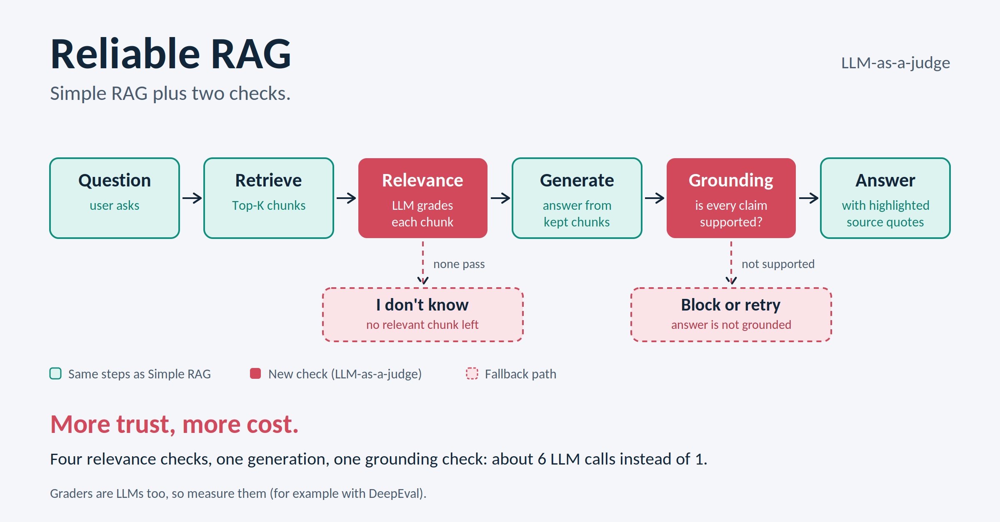

# Reliable RAG

Simple RAG plus two LLM-as-a-judge checks: one before generation to drop irrelevant chunks, and one after generation to verify the answer is grounded in the sources.



## Why

Simple RAG passes whatever the retriever returns straight to the LLM. If a wrong chunk comes back, the model can answer wrongly with full confidence. Reliable RAG adds a guard on both sides of the generation step.

## How it works

1. **Retrieve:** fetch the Top-K chunks from the vector store (k = 4).
2. **Relevance check:** an LLM grades each chunk `yes` or `no`, and only the relevant ones are kept.
3. **Generate:** the answer is written only from the kept chunks.
4. **Grounding check:** a second grader checks whether the answer is supported by those chunks.
5. **Fallbacks:** if no chunk is relevant, the system says it doesn't know instead of guessing.

## Stack

- LangChain
- OpenAI (`ChatOpenAI` for generation and grading, `OpenAIEmbeddings` for embeddings)
- Chroma as the vector store
- `WebBaseLoader` with a tiktoken-based splitter (500 tokens, no overlap)

## Setup

Create a `.env` file next to the notebook:

```
OPENAI_API_KEY=your_key_here
```

Then open `reliable_rag.ipynb` and run the cells in order.

## Example

> **Question:** (paste the question you tested)
> **Chunks kept:** (for example, 3 of 4)
> **Answer:** (paste the generated answer)
> **Grounding check:** `yes`

## Cost and trade-offs

With k = 4, one question takes about 6 LLM calls (4 relevance checks, 1 generation, 1 grounding check) instead of 1 in Simple RAG. That means higher cost and latency in exchange for more trust in the answer.

## Limitations

- The graders are LLMs, so they can make mistakes: they may drop a useful chunk or accept a weak one.
- The grounding check gives one verdict for the whole answer. It doesn't say which claim is unsupported.
- If the right chunk never comes back from retrieval, the checks can't recover it. That needs hybrid search or re-ranking.

## Next steps

- Hybrid search (BM25 + embeddings)
- Re-ranking
- Evaluate the graders on a labeled set of questions

## Credits

Based on the Reliable RAG technique and notebook from [original source](link-here), adapted to use OpenAI.

## License

MIT
